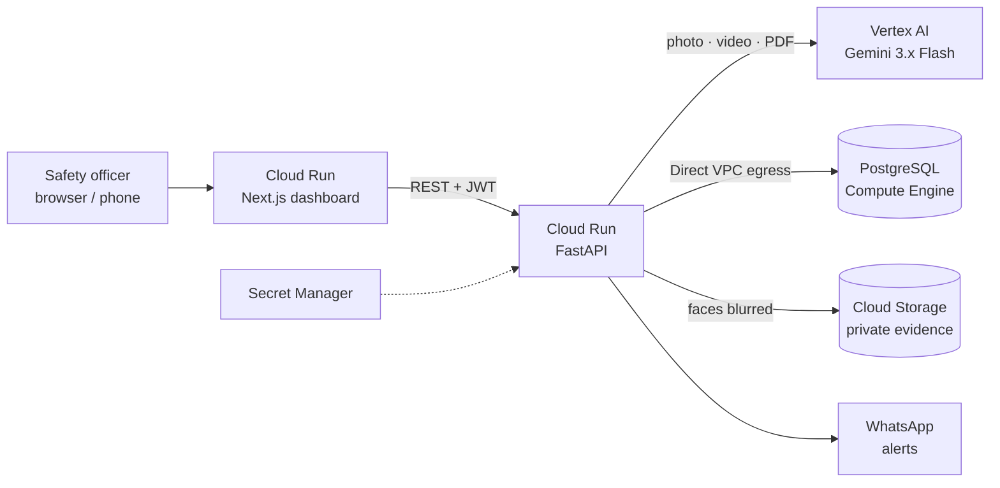

# SafeSight — AI that sees workplace hazards before they become incidents

[](https://cloud.google.com)
[](https://cloud.google.com/vertex-ai)
[](https://cloud.google.com/run)

> **Languages:** 🇬🇧 English | 🇮🇩 [Bahasa Indonesia](README_ID.md)

**Live demo:** https://ehs-web-6hw2nfb45q-uc.a.run.app · login `admin@globalmfg.com` / `admin123`

SafeSight turns any CCTV camera or phone into a safety inspector. Gemini looks at a photo or a CCTV clip, recognises
the work being done, applies the right company safety policy, boxes every hazard on the image, and escalates
in seconds, while blurring faces and discarding footage of safe work.

---

## The problem

- **Safety officers can't be everywhere.** One officer may cover dozens of active work areas; most violations are never seen.
- **Hours of CCTV, nobody watching.** Cameras record hazards but no one reviews the footage until after an accident.
- **Rules live in PDFs.** SOPs are long documents, not something a camera can check.

Every year roughly 395 million workers are injured at work worldwide (ILO). Most serious incidents are preceded by
visible unsafe acts and conditions: a missing harness, a pedestrian in a forklift lane, sparks next to gas cylinders.

## What SafeSight does

| Capability | What happens | Gemini feature |
|---|---|---|
| **Photo inspection with visual evidence** | Every finding is drawn as a labelled box on the image, with severity and confidence | Spatial understanding (`box_2d`), structured output |
| **CCTV video review** | Upload a clip; get a timestamped violation timeline and jump to each moment | Native video understanding |
| **Policy auto-detection** | Gemini identifies the activity (e.g. hot work, working at height) and picks the matching company policy | Reasoning over policy list |
| **SOP → enforceable rules** | Upload an SOP PDF; Gemini compiles PPE, prerequisites, forbidden hazards and limits into a policy | Native PDF understanding |
| **Instant escalation** | Stop-work order or warning, WhatsApp alert with the evidence photo | — |
| **One-click incident report** | 5-Whys root cause and corrective actions ranked by the hierarchy of controls, printable as PDF | Structured generation |
| **Agentic EHS Co-Pilot** | Ask "Which area is our biggest risk this fortnight?"; the agent queries the live database and shows which tools it used | Function calling |
| **Risk dashboard** | Inspections, compliance rate, 14-day trend, fatal-risk categories and hotspot locations | — |

## Responsible AI by design

- **Never invents a verdict.** If no Gemini model answers, the API returns an error and records nothing; it never
  guesses a violation or stops work on a hunch.
- **Privacy first.** Faces are blurred before evidence is stored or sent, and photos of compliant work are not stored at all.
- **Deterministic guardrails.** Any CRITICAL finding always becomes a stop-work order, whatever the model's wording.
- **Humans stay in charge.** Incident reports are marked as AI-assisted drafts with sign-off lines; every verdict is reviewable with its evidence.
- **Measured, not claimed.** See the [evaluation](docs/EVALUATION.md): 100 % of violations caught on the test set, with false positives analysed one by one.

## Architecture



- **Fallback chain:** `gemini-3.6-flash → 3.8-flash → 3.5-flash → 2.5-flash`, so one busy model never blocks an inspection.
- **Private by default:** the evidence bucket has public access prevention on; the API streams evidence through unguessable URLs.

## Evaluation

| Metric | Result |
|---|---|
| Violations caught (recall) | **100 %** |
| Accuracy (after policy adjudication) | **87.5 %** |
| Median time per photo | ~13 s |

16 human-reviewed test images, production code path. Method, per-image results and limits: [docs/EVALUATION.md](docs/EVALUATION.md).

## Run it

**Local (Docker):**
```bash
cp backend/.env.example backend/.env     # add GEMINI_API_KEY, or set GOOGLE_GENAI_USE_VERTEXAI=true
cd docker && docker compose up -d --build
# dashboard http://localhost:3000 · API docs http://localhost:8000/docs
```
The database is created and seeded with demo data on first start.

**Google Cloud (one command):**
```bash
PROJECT_ID=your-project ./deploy/deploy-cloudrun.sh
```
Creates the service account, private evidence bucket, secrets, an e2-micro Postgres VM and two Cloud Run services,
with Gemini on Vertex AI. Re-run it to redeploy.

## API

| Method | Endpoint | Purpose |
|---|---|---|
| `POST` | `/api/v1/inspections/audit` | Photo inspection (`policy_id=auto` to auto-detect) |
| `POST` | `/api/v1/inspections/video` | CCTV clip inspection with timeline |
| `POST` | `/api/v1/inspections/{id}/report` | Incident investigation report |
| `GET`  | `/api/v1/inspections/history` | Inspection history with evidence |
| `GET`  | `/api/v1/dashboard/metrics` | KPIs, trend, risk breakdown, hotspots |
| `POST` | `/api/v1/copilot/chat` | Agentic Co-Pilot |
| `POST` | `/api/v1/policies/upload-sop` | Compile an SOP PDF into a policy |

Interactive docs at `/docs` on the API service.

## Tech stack

Gemini on Vertex AI (`google-genai`) · FastAPI · SQLAlchemy · PostgreSQL · Next.js 14 · Tailwind CSS ·
Cloud Run · Cloud Build · Artifact Registry · Cloud Storage · Secret Manager · Compute Engine · Pillow.
A SwiftUI companion app (`mobile-ios/`) adds voice SOS reporting.

## Roadmap

- Live RTSP camera streams with continuous monitoring
- Digital work permits with crew manifests (already in the codebase, disabled for this release)
- On-device pre-filtering for sites with poor connectivity
- Evaluation on real labelled CCTV footage
